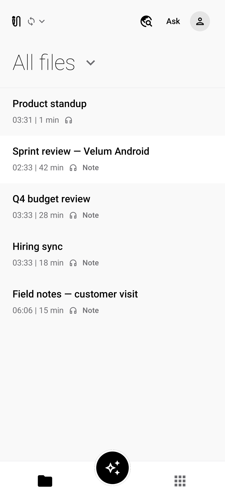
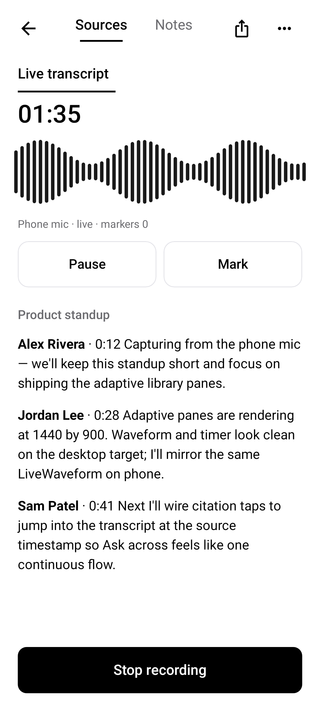
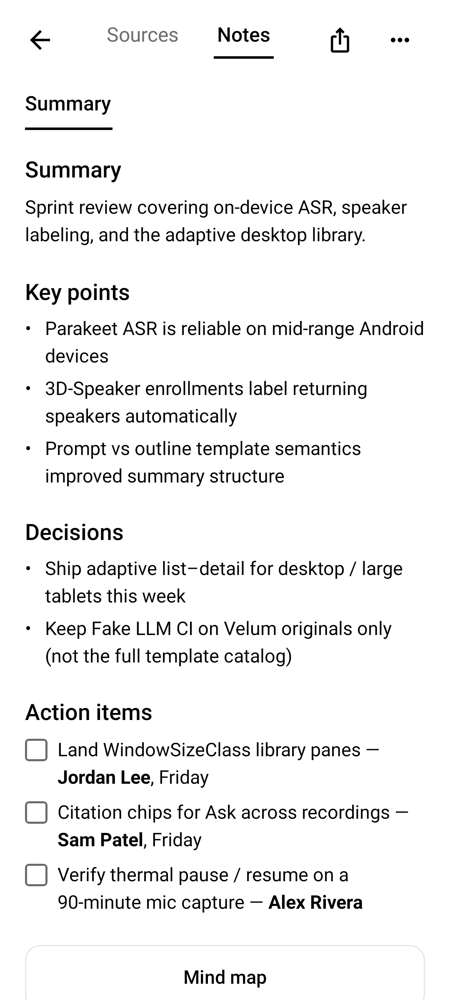
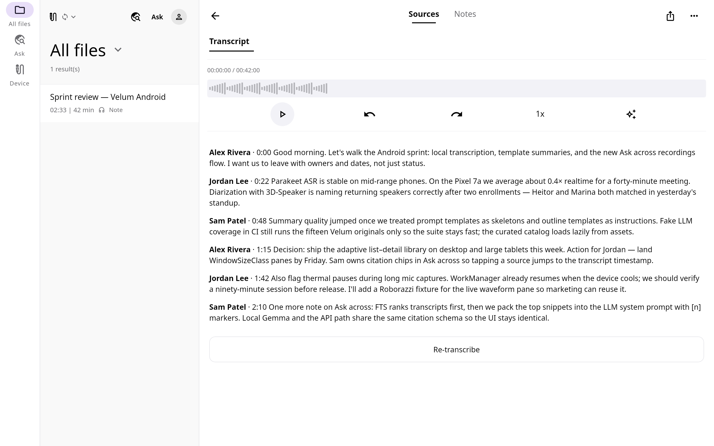

<p align="center">
  
</p>

<h1 align="center">Velum</h1>

<p align="center">
  <strong>Turn conversations into notes you can use.</strong><br />
  Record, transcribe, and organize your audio with your choice of AI.
</p>

<p align="center">
  <a href="#start-here">Get started</a> ·
  <a href="#your-audio-your-choice-of-ai">How it works</a> ·
  <a href="#platforms-and-progress">Project status</a> ·
  <a href="CONTRIBUTING.md">Contribute</a> ·
  <a href="#em-português">Português</a>
</p>

<p align="center">
  <a href="LICENSE"></a>
  
  
</p>

Velum is an open-source app for recordings, transcripts, and AI notes. Capture a meeting on your phone or import existing audio, then turn it into a transcript and a summary shaped for the work at hand. Keep your library on your device and choose local models or an API provider you trust.

**No Velum account. No mandatory Velum server. No Velum subscription.** External API providers may charge for usage.

<table>
  <tr>
    <th width="33%">Keep your recordings together</th>
    <th width="33%">Capture the conversation</th>
    <th width="33%">Leave with useful notes</th>
  </tr>
  <tr>
    <td></td>
    <td></td>
    <td></td>
  </tr>
</table>

<sub>Actual shared Compose UI rendered with demo data. Android captures use Roborazzi, not a physical-device recording. Text inside the examples is sample content, not a performance or release claim. [Capture sources and gallery](docs/site-screenshots/README.md).</sub>

## Make the recording worth keeping

- **Spend less time replaying audio.** Read transcripts with timestamps and speaker labels, then review the parts that matter.
- **Give each conversation the right format.** Use templates for meeting notes, interviews, and other summaries. Edit templates to suit your own workflow.
- **Bring the audio you already have.** Import files, share audio into the Android app, or sync a watched folder. A matching recording in Trash gets a warning rather than an automatic restore.
- **Find answers in your library.** Search recordings and use Ask across recordings to explore transcript content with source references.
- **Cut down repeat work.** AutoFlow rules connect recording conditions with processing and follow-up actions. See the [AutoFlow guide](docs/autoflow-templates.md).
- **Take your notes with you.** Share or export your results instead of keeping them tied to a proprietary cloud account.

These flows are implemented in the project; platform coverage and remaining validation are described below. AI output still needs your review.

## Your audio, your choice of AI

| Choose | What it means |
| :--- | :--- |
| Local processing | Download supported models and run supported tasks on your device. Model availability, storage, memory, and processing speed depend on your hardware. |
| Your own API | Configure an OpenAI-compatible endpoint and key, refresh its model list, and choose models for supported tasks. The selected provider receives the data needed for those requests. |
| Your own workflow | Choose templates and AutoFlow rules for the way you work. Optional integrations and webhooks send data only when you configure and use them. |

Recordings and notes live in a local SQLDelight database and app storage. Velum has no telemetry or crash-reporting service. On Android, API keys and imported device identity use an Android Keystore-backed encrypted store.

Read the [privacy policy](docs/PRIVACY.md) for network behavior, permissions, and optional sharing.

## Start here

Velum is in active development. Start with a development build if you want to try the current app or contribute; this README does not announce a store-ready release.

1. **Build and open the Android app** using the commands below.
2. **Choose your processing setup.** In Settings, download a supported local model, or enter an OpenAI-compatible base URL and API key. Refresh the model list and select the models your provider supports.
3. **Try a short recording or import a small audio file.** Generate a transcript, choose a summary template, and review the result before relying on it.

You do not need a Plaud recorder to try phone recording or file import.

### Using a Plaud recorder

Velum includes a direct BLE integration targeting Plaud Note Pro, with local Wi-Fi transfer support in the protocol implementation. Compatibility depends on the device and firmware; real-hardware validation remains open. See the [hardware validation checklist](docs/HARDWARE_VALIDATION.md) before treating a device as supported.

For hardware you own, **Settings → Import from Plaud** accepts identity material exported from your own account. Follow the [import guide](docs/PLAUD_IMPORT.md). Never post identity bundles, private keys, or account tokens in an issue.

Velum is an independent project, not affiliated with, endorsed by, or sponsored by Plaud Inc. Product names identify interoperability targets. [Legal and interoperability notes](docs/LEGAL.md).

## Platforms and progress

| Platform | Current scope |
| :--- | :--- |
| **Android** | Primary development and acceptance target. Recording, import, transcript, notes, templates, and automation flows are implemented; full regression and device acceptance work continues. |
| **macOS** | Desktop development is in progress. The shared interface includes a wide library and note view. Microphone, system-audio, and packaging acceptance are still being completed. |
| **Windows / Linux** | Outside the current desktop delivery phase. Shared JVM code does not imply platform acceptance. |
| **iOS** | Deferred until the Android acceptance criteria are proved. Source targets exist, but they are not a readiness claim. |

### More room for your notes

<p align="center">
  
</p>

<sub>Real Compose Desktop UI rendered by ImageComposeScene with demo data. This shows the adaptive layout, not completed macOS capture or hardware validation.</sub>

Browse the [light and dark Android gallery](docs/screenshots/README.md), [desktop and mobile captures](docs/site-screenshots/README.md), [roadmap](ROADMAP.md), and [open issues](https://github.com/bloodf/velum/issues) for more detail.

## Build from source

You will need Git, JDK 17, and Android SDK Platform 36. The Android app targets API 35 and supports API 26 or later. The Gradle wrapper is included.

```bash
git clone https://github.com/bloodf/velum.git
cd velum
./gradlew :composeApp:assembleDebug
```

The development APK is written to `composeApp/build/outputs/apk/debug/composeApp-debug.apk`. You can also open the project in Android Studio and run it on your own Android device.

For focused JVM checks or the desktop development app:

```bash
./gradlew :plaud-protocol:jvmTest :ai:jvmTest
./gradlew :composeApp:run
```

See [CONTRIBUTING.md](CONTRIBUTING.md) for environment setup, verification, and packaging details. Signing and distribution are separate from development builds.

<details>
<summary><strong>For contributors: project layout</strong></summary>

| Directory | Responsibility |
| :--- | :--- |
| `composeApp/` | Shared Compose UI and platform implementations |
| `core/` | Domain models, SQLDelight storage, settings, and templates |
| `ai/` | Local and API engines, audio processing, models, and jobs |
| `ble/` | Recorder communication and platform BLE transports |
| `plaud-protocol/` | Pure Kotlin protocol codec and cryptography |
| `recorder/` | Recording support |
| `iosApp/` | Deferred iOS host |
| `docs/` | Architecture, interoperability, validation, and brand assets |

Built with Kotlin Multiplatform, Compose Multiplatform, Ktor, SQLDelight, and Kable. See the [AI architecture](docs/ARCHITECTURE_AI.md) and [protocol notes](docs/protocol/README.md).

Screenshot generation is documented in the galleries above. Brand files and usage notes live in the [brand catalog](docs/brand/README.md).

</details>

## Help shape Velum

Try a workflow you care about and [report what worked or failed](https://github.com/bloodf/velum/issues). Include your app version, platform, and reproducible steps, with private audio and credentials removed. Contributions to code, tests, translations, and original templates are welcome; start with the [contribution guide](CONTRIBUTING.md).

## Em português

**Transforme conversas em notas que você pode usar.** Grave no Android ou importe um áudio, gere a transcrição e escolha um template para organizar o resumo. O Velum mantém sua biblioteca no aparelho e permite escolher modelos locais ou uma API compatível com OpenAI.

Não há conta, servidor ou assinatura obrigatória do Velum. Provedores externos podem cobrar pelo uso. O projeto está em desenvolvimento: Android é a prioridade, o desktop desta fase é macOS, e iOS vem depois. As imagens mostram a interface real com dados de demonstração, não uma certificação de funcionamento em hardware.

Para experimentar, siga [Build from source](#build-from-source). Para participar, veja [CONTRIBUTING.md](CONTRIBUTING.md).

## License and acknowledgments

Velum is licensed under [MIT](LICENSE). Protocol research builds on community work, including [plaude-archiver](https://github.com/roopen219/plaude-archiver) and [OpenPlod](https://github.com/OpenPlod/OpenPlod). Attribution and interoperability details are in [docs/protocol](docs/protocol/README.md) and the [legal notes](docs/LEGAL.md).
