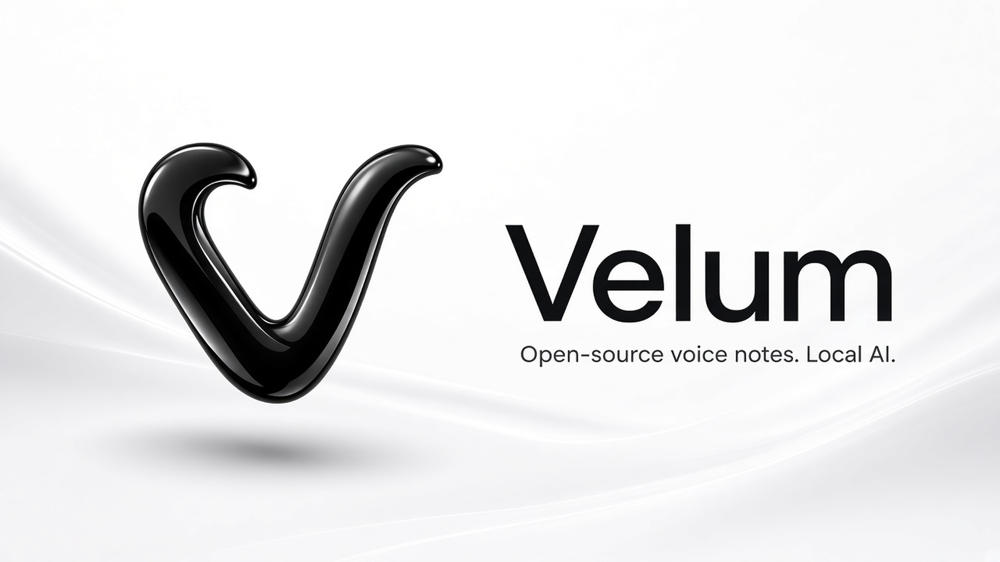
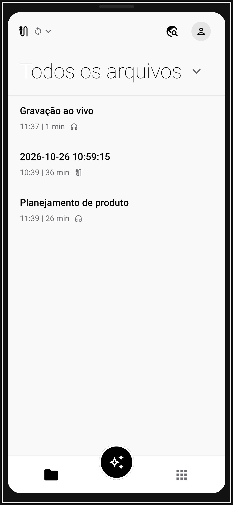
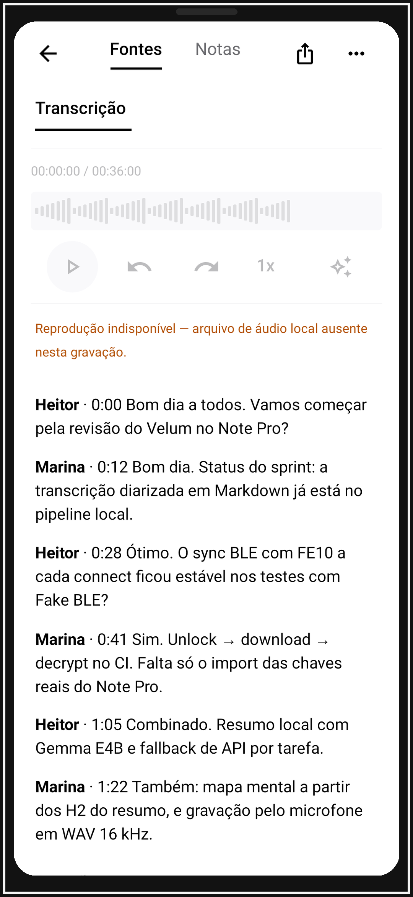
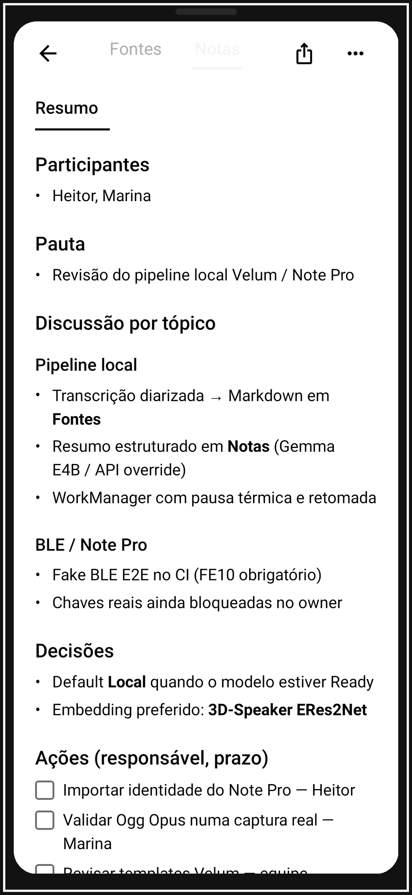
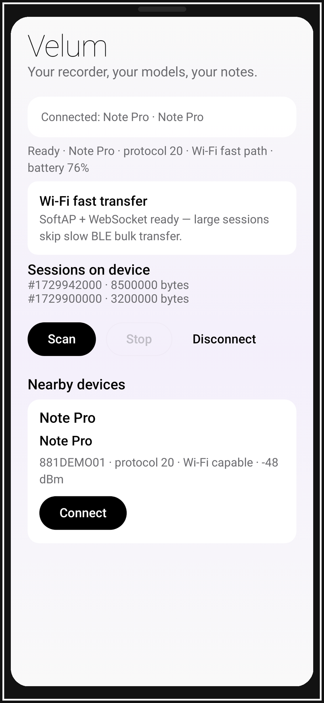

<p align="center">
  
</p>

# Velum

**Your recorder, your models, your notes.**

Velum is an open-source, subscription-free companion for the [Plaud Note Pro](https://www.plaud.ai/) (and, over time, other Plaud models/firmwares). It runs **standalone with no Velum server**: the phone talks to the device over BLE, you bring your own OpenAI-compatible base URL + API key, refresh `/models`, and get transcription, template summaries, and agents — local-first.

> **Independent project.** Velum is not affiliated with, endorsed by, or sponsored by Plaud Inc. “Plaud” and “Note Pro” are used only to describe device compatibility. See [docs/LEGAL.md](docs/LEGAL.md).

## Status

**Foundation (M0)** — repository, KMP modules, protocol codec + tests, AI client, BLE interface (Kable on mobile, stub on desktop), Compose Multiplatform shell (Device / Recordings / Settings).

**Focus right now: Android.** The KMP layout keeps iOS targets for later (M3), but day-to-day work and CI target **Android + JVM tests** only. No Xcode project is maintained yet.

Not yet: full BLE sync/download/decrypt on device, templates, desktop system-audio recorder, sync, integrations, speaker ID.

## Architecture

```
composeApp/          Compose Multiplatform UI (Android, iOS, Desktop JVM)
core/                Domain models, settings, secure-storage abstractions
plaud-protocol/      Pure Kotlin BLE protocol codec (framing, unlock types, sessions, PLAUD.AI header)
ai/                  OpenAI-compatible client (Ktor): /models, transcriptions, chat
ble/                 BleTransport + Kable (Android/iOS) + desktop stub
iosApp/              Thin SwiftUI host for the Compose framework
docs/                Protocol notes, legal / interoperability
docs/brand/          Brand masters + web/exact-size exports
docs/screenshots/    App UI captures (light / dark / framed)
fastlane/metadata/   Play / F-Droid listing assets
```

Stack: **Kotlin Multiplatform + Compose Multiplatform**, **Kable** (mobile BLE), **Ktor**, local-first SQLite planned via SQLDelight. License: **Apache-2.0**.

## Brand

All brand art is black & white 3D, matching the launcher icon. Catalog: [docs/brand/README.md](docs/brand/README.md).

| Asset | Path |
|-------|------|
| README banner (~1600 px) | [docs/brand/sized/readme-banner-1600.png](docs/brand/sized/readme-banner-1600.png) |
| Launcher (light) | [docs/brand/icon-3d-light.jpg](docs/brand/icon-3d-light.jpg) — **always** used for the home-screen icon |
| Dark mark | [docs/brand/icon-3d-dark.jpg](docs/brand/icon-3d-dark.jpg) — splash / in-app when the system theme is dark |
| Splash light / dark | [docs/brand/splash-light.jpg](docs/brand/splash-light.jpg) · [docs/brand/splash-dark.jpg](docs/brand/splash-dark.jpg) |
| Wordmark (About) | [docs/brand/wordmark-light.jpg](docs/brand/wordmark-light.jpg) |
| Flat V (monochrome / notification) | [docs/brand/velum-v.svg](docs/brand/velum-v.svg) |
| Play feature graphic 1024×500 | [docs/brand/sized/play-feature-graphic-1024x500.png](docs/brand/sized/play-feature-graphic-1024x500.png) |
| GitHub social 1280×640 | [docs/brand/sized/github-social-preview-1280x640.png](docs/brand/sized/github-social-preview-1280x640.png) |
| WebP / PNG exports | [docs/brand/web/](docs/brand/web/) |
| Store listing pack | [fastlane/metadata/android/](fastlane/metadata/android/) |

**Dark vs light:** the Android launcher cannot switch icons by theme — keep the light 3D icon on the home screen. Splash, first-run hero, and About hero follow the system theme (`splash-light` / `splash-dark`). The About dialog also shows the light wordmark.

> **GitHub social preview:** upload `docs/brand/sized/github-social-preview-1280x640.png` manually under **Settings → General → Social preview**. Git does not set this for you.

## Screenshots

Real Compose UI captures (Roborazzi, ≈1080×2400). No Plaud marketing art — Velum UI with seeded demo data. Light + dark galleries live under [`docs/screenshots/`](docs/screenshots/); store listing copies are in [`fastlane/metadata/android/`](fastlane/metadata/android/).

<p align="center">
  
  
  
  
</p>

| Screen | Light | Dark |
|--------|-------|------|
| Onboarding | [01](docs/screenshots/light/01-onboarding.png) | — |
| Home / recordings | [02](docs/screenshots/light/02-home-recordings.png) | [02](docs/screenshots/dark/02-home-recordings.png) |
| Recording in progress (phone mic) | [04](docs/screenshots/light/04-recording-in-progress.png) | — |
| Device connected + Wi‑Fi fast transfer | [05](docs/screenshots/light/05-device-connected-wifi.png) | [05](docs/screenshots/dark/05-device-connected-wifi.png) |
| Import hub | [06](docs/screenshots/light/06-import-hub.png) | — |
| Transcript + speakers | [07](docs/screenshots/light/07-transcript-speakers.png) | [07](docs/screenshots/dark/07-transcript-speakers.png) |
| Summary (template) | [08](docs/screenshots/light/08-summary-template.png) | [08](docs/screenshots/dark/08-summary-template.png) |
| Template picker | [11](docs/screenshots/light/11-template-picker.png) | — |
| Voice profiles | [12](docs/screenshots/light/12-voice-profiles.png) | — |
| AI processing (Local vs API) | [13](docs/screenshots/light/13-ai-processing.png) | [13](docs/screenshots/dark/13-ai-processing.png) |

Regenerate:

```bash
./gradlew :composeApp:recordRoborazziDebug
./scripts/package-screenshots.sh
```

## Build

Requirements:

- JDK 17+
- Android SDK 35 (for Android targets)
- Xcode (for iOS, macOS only)

```bash
./gradlew :plaud-protocol:jvmTest :ai:jvmTest
./gradlew :composeApp:assembleDebug
./gradlew :composeApp:run          # desktop
```

CI builds JVM tests + Android debug APK on Linux (no iOS job until M3).

Android API keys and device identity material use **Android Keystore AES-GCM** (`AndroidSecureStore`); ciphertext only is stored in private prefs.

## Configure AI

In **Settings**:

1. Set your OpenAI-compatible **base URL** (e.g. `https://api.openai.com/v1`, Groq, OpenRouter, LM Studio, Ollama).
2. Paste an **API key** (stored via platform secure storage abstraction — never committed).
3. Tap **Refresh** to call `GET /models` and pick a model.

## Device keys

Plaud Note Pro protocol 20 needs a one-time import of identity material from *your* Plaud account (serial signature, RSA key pair, bind token). Velum exposes a `DeviceKeyImporter` interface and **never ships secrets**. Import UI arrives with M1.

## Contributing

See [CONTRIBUTING.md](CONTRIBUTING.md) and [ROADMAP.md](ROADMAP.md).

## Português (resumo)

Velum é um app open source, **sem assinatura e sem servidor obrigatório**, para o Plaud Note Pro: BLE direto no aparelho, você coloca a URL/chave da API OpenAI-compatível, atualiza a lista de modelos e usa transcrição/resumo localmente. Stack: Kotlin Multiplatform + Compose (Android, iOS, desktop). Status atual: fundação (protocolo, cliente de IA, shell da UI). Não somos afiliados à Plaud — ver `docs/LEGAL.md`.

## Credits

Protocol understanding builds on community work (MIT), especially:

- [plaude-archiver](https://github.com/roopen219/plaude-archiver)
- [OpenPlod](https://github.com/OpenPlod/OpenPlod)

Adapted notes: [docs/protocol/](docs/protocol/).
